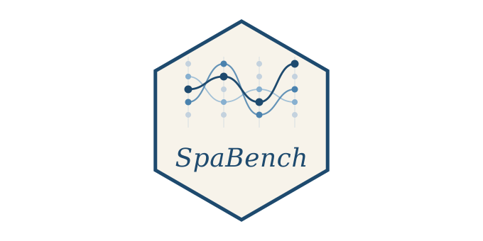
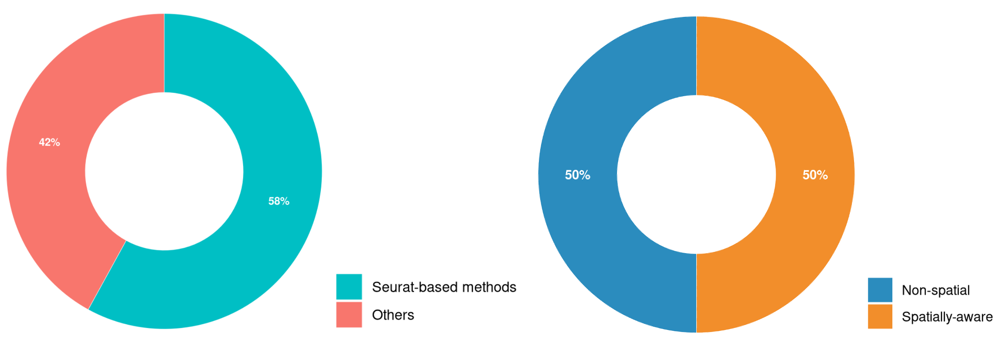

# SpaBench


Building upon Snakemake, SpaBench is a comprehensive sequencing-based spatial transcriptomics benchmarking workflow which implements 24 distinct methods (non-spatial and spatially-aware ones) into 400 different workflow combinations. SpaBench begins from raw spatially-resolved gene count matrix, followed by normalization, feature selection, dimensionality reduction, and clustering. As the end point, SpaBench utilizes SingleR for cell type/spatial domain annotation and computes QC metrics, including both non-spatial ones such as NMI, HOM, COM, CHAOS, PAS, and ASW.

# SpaBench Explorer
SpaBench Explorer is an interactive companion app for our benchmarking study of a variety of sequencing-based spatial transcriptomics workflows. It allows you rank and filter workflows by metrics, inspect per-spot workflow results against the ground truth labels, decompose which pipeline step drives performance variance, and explore default-vs-tuned parameter effects. Built with R Shiny; live at (https://yangxuboom.shinyapps.io/SpaBench-explorer/).

## Overview of Algorithm Implementation


| Algorithm | Functional Step | Language | Reference |
| --- | --- | --- | --- |
| `Seurat` | Object construction & Normalization & Feature selection & Dimensionality reduction & Clustering | R | [Hao et al. (2023)](https://www.nature.com/articles/s41587-023-01767-y)
| `Squidpy` | Object construction & Image feature computation | Python | [Palla et al. (2022)](https://www.nature.com/articles/s41592-021-01358-2)
| `SpatialExperiment` | Object construction | R | [Righelli et al. (2022)](https://academic.oup.com/bioinformatics/article/38/11/3128/6575443)
| `SpaNorm` | Normalization | R | [Salim et al. (2025)](https://genomebiology.biomedcentral.com/articles/10.1186/s13059-025-03565-y)
| `nnSVG` | Feature selection | R | [Weber et al. (2023)](https://www.nature.com/articles/s41467-023-39748-z)
| `SPARK` | Feature selection | R | [Sun et al. (2020)](https://www.nature.com/articles/s41592-019-0701-7)
| `SPARK-X` | Feature selection | R | [Zhu et al. (2021)](https://genomebiology.biomedcentral.com/articles/10.1186/s13059-021-02404-0)
| `SpatialPCA` |  Dimensionality reduction & Clustering | R | [Shang et al. (2022)](https://www.nature.com/articles/s41467-022-34879-1)
| `SpatialLeiden` | Clustering | Python | [Müller-Bötticher et al. (2025)](https://genomebiology.biomedcentral.com/articles/10.1186/s13059-025-03489-7)
| `stlearn` | Clustering | Python | [Pham et al. (2023)](https://www.nature.com/articles/s41467-023-43120-6 )
| `BANKSY` | Clustering | R & Python | [Singhal et al. (2023)](https://www.nature.com/articles/s41588-024-01664-3)
| `BayesSpace` | Clustering | R | [Zhao et al. (2021)](https://www.nature.com/articles/s41587-021-00935-2)
| `SpaGCN` | Clustering | Python | [Hu et al. (2021)](https://www.nature.com/articles/s41592-021-01255-8)
| `SingleR` | Annotation | R | [Aran et al. (2019)](https://www.nature.com/articles/s41590-018-0276-y)

## Hyperparameter optimization
Algorithms included in `SpaBench` include configurable parameters to help obtaining the optimal downstream results. Optuna is implemented in `optimize_parameter.py` as a refinement module to speed up the process of hyperparameter optimization.

## To run the whole workflow: [Not recommend for large datasets]
```
module load snakemake
snakemake -j 16
```

## To run specific branch of workflow:
```
# In this case we want SpaGCN clustering results from 2 Normalization * 5 Feature selection combinations which is 10
snakemake -j 8 -p /pathtodata/{LogNormalize,SCTransform}/{vst,moransi,nnSVG,SPARK,SPARK-X}/SpaGCN/06_SpaGCN_clustered.rds
```

## To run particular step:
```
snakemake data/CLR/nnSVG/BayesSpace/06_BayesSpace_clustered.rds -j 16 -p --allowed-rules cluster_BayesSpace 
```

## To run cell type/spatial domain annotation with QC metrics computation:
```
snakemake   $(find results/data -type f -name "07_*_clusters.csv" \
     | sed -e 's#/07_\(.*\)_clusters.csv#/09_\1_annotated.rds#')   --cores 16 -p --allowed-rules annotate_clusters
snakemake   $(find results/data -type f -name "07_*_clusters.csv" \
     | sed -e 's#/07_\(.*\)_clusters.csv#/09_\1_metrics.csv#')   --cores 16 -p --allowed-rules compute_metrics
```

## To check result completeness:
```
python scripts/check.py -s /path/to/data
```
It checks if anything is missing from the 400 combinations, below is an example.
```
============================================================
Checked 400 expected '06_*_clustered.rds' files for 1 sample dir(s).
  Found: 399    Missing: 1
------------------------------------------------------------
Sample dir: data/sample1
  expected: 400, found: 399, missing: 1
============================================================

Missing files (first 200 shown):
  data/sample1/LogNormalize/SPARK/leiden/06_leiden_clustered.rds
```

## Resource Management
Snakemake can automatically determine which parts of the workflow can be run in parallel by specifying more than one available core:
```
snakemake --cores 16 /pathtodata/{CLR,LogNormalize,RC,SCTransform}/{vst,mvp,disp,markvariogram,moransi,nnSVG,SPARK,SPARK-X}/{BANKSY, BayesSpace. leiden, louvain, louvain_refine, SLM, SpatialPCA, stlearn, SpaGCN}/06_*_clustered.rds
```
## Before running this workflow, check the following information:
### Input data format
Before running the downstream analysis, it is highly recommended to create input objects using: 
``` 
snakemake -j 8 -p  data/sample/01_raw_seurat.rds
```
Followed by checking the data format using:
```
Rscript scripts/check_input.R data/sample/01_raw_seurat.rds
```

### Common bugs
1. Wrong arguments, the following bug means you probably put a wrong name that Snakefile cannot recognize.
```diff
# leiden and louvain are inconsistent in this case
- snakemake data/CLR/nnSVG/leiden/06_louvain_clustered.rds -j 16 -p
- MissingRuleException:
- No rule to produce .....
```
2. Missing required inputs, this usually happens when you use `--allowed-rules` but forgot to run previous steps.
```diff
- MissingInputException in rule cluster_stlearn in file "./Snakefile", line 461:
- Missing input files for rule cluster_stlearn:...
```
3. Incomplete results, this can happen when previous job fails.
```diff
- IncompleteFilesException:
- The files below seem to be incomplete. If you are sure that certain files are not incomplete, mark them as complete with

-     snakemake --cleanup-metadata <filenames>

- To re-generate the files rerun your command with the --rerun-incomplete flag.
- Incomplete files:
- data/LogNormalize/moransi/03_moransi.rds
```
To address this
```diff
+ snakemake --cleanup-metadata data/LogNormalize/moransi/03_moransi.rds
```
4. Note SpaBench only allows parallel processing of samples from the same technical platform - do not run Visium and Stereoseq data at the same time.

### Master Snakemake
Learn more techniques in [Snakemake documentation](https://snakemake.readthedocs.io/en/stable/).
